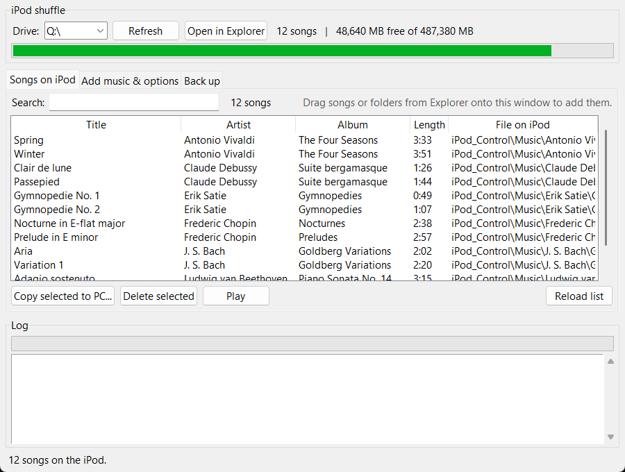

# Shuffle Manager: iPod shuffle 4th gen on Windows, without iTunes

A small Windows app for managing the music on an **iPod shuffle (4th generation)** without iTunes.
You can add songs by dragging them onto the window, see and search what is on the iPod, copy songs
back to the PC, delete them, and back up the whole iPod. It comes as a single `.exe`, so nothing
needs to be installed.

It is built on **[nims11/IPod-Shuffle-4g](https://github.com/nims11/IPod-Shuffle-4g)**, the
open-source Python script that writes the iPod's song database. This project adds two fixes that
make that script work on Windows, and puts a window around it.



*The app reading a demo folder mapped as a drive. On a real iPod the free-space figure is the
iPod's own.*

---

## Why this is needed

The shuffle 4G shows up in Windows as an ordinary USB drive, but it **only plays songs that are
listed in its own database** (`iPod_Control\iTunes\iTunesSD`). iTunes normally writes that file.
Songs copied in File Explorer are simply ignored until the database is rebuilt.

[IPod-Shuffle-4g](https://github.com/nims11/IPod-Shuffle-4g) rebuilds the database from whatever
audio files are on the iPod. Shuffle Manager runs it for you every time you add or delete songs.

## Features

- **Finds the iPod by itself.** Every drive letter that has an `iPod_Control` folder is listed.
  Shows the number of songs and the free space.
- **Songs on iPod:** a list of every song with title, artist, album and length (read from the
  tags), and a search box. Buttons to **copy selected songs to the PC**, **delete** them, or
  **play** one.
- **Add music:** drag songs or folders from File Explorer onto the window and they are copied
  straight to the iPod. You can also queue files or folders and choose the folder name on the iPod.
  Songs that are already there are skipped, and songs that do not fit are listed in the log. The
  app always leaves 16 MB free for the database.
- **The database is rebuilt automatically** after every add or delete. There is also a
  **Rebuild now** button.
- **Rebuild options** (these are the script's own options): playlists by folder (with a depth
  limit) or by tag (for example `{artist}`), volume boost (0–99), renaming of file names the iPod
  cannot store, and a detailed log.
- **Back up:** copies every song off the iPod into `Artist\Album\Title` folders with readable names,
  and writes a `song-list.csv`. This is useful because an iPod filled by iTunes stores its music
  under scrambled names in `F00`–`F49`.

Supported audio formats are the ones the iPod plays: `.mp3`, `.m4a`, `.m4b`, `.wav` and `.aa`.
Purchased `.m4p` files are included in backups.

📖 **[User manual](docs/MANUAL.md)**: every feature explained in detail, with why it matters and how to use it.

## Download and run

1. Download **`ipod-shuffle-4g-windows.exe`** from the
   [Releases](https://github.com/rodrigohuber/ipod-shuffle-4g-windows/releases) page.
2. Plug in the iPod shuffle and double-click the exe.
3. The exe is not code-signed, so Windows SmartScreen warns the first time. Click
   **More info → Run anyway**.

You do not need Python to run the exe.

> **Before the first use, back up your iPod.** Use the **Back up** tab, or copy the whole drive
> somewhere safe. If the iPod was filled by iTunes, also copy `iPod_Control\iTunes` and
> `iPod_Control\Speakable` as they are. Copying those two folders back restores the original
> database and voice prompts.

## Run from source

You need **Windows 10 or 11** and **[Python 3.12](https://www.python.org/downloads/)**. Tick
"Add python.exe to PATH" in the installer, which also installs the `py` launcher.

```bat
git clone https://github.com/rodrigohuber/ipod-shuffle-4g-windows.git
cd ipod-shuffle-4g-windows
py -3.12 -m venv .venv
.venv\Scripts\python -m pip install -r requirements.txt
.venv\Scripts\python src\shuffle_manager.py
```

`tkinter` comes with the standard Python installer. `mutagen` reads the song tags, and
`tkinterdnd2` adds drag and drop. Without `tkinterdnd2`, everything except dragging still works.

## Build the exe yourself

```bat
git clone https://github.com/rodrigohuber/ipod-shuffle-4g-windows.git
cd ipod-shuffle-4g-windows
build.cmd
```

The first run of `build.cmd` creates `.venv` and installs the exact versions in
`requirements-build.txt` (PyInstaller 6.22.3 and its dependencies). It then writes
**`dist\ipod-shuffle-4g-windows.exe`**, about 13 MB. Later runs reuse `.venv`.

The exe contains the app, the database builder (`src\ipod_shuffle_4g.py`) and the license.
Rebuilds run inside the exe itself: the app starts itself with `--run-tool <options>`, so a frozen
build needs no separate Python.

## Using the database builder without the window

The bundled builder accepts the same options as upstream:

```bat
.venv\Scripts\python src\ipod_shuffle_4g.py --help
.venv\Scripts\python src\ipod_shuffle_4g.py -i "{artist}" D:\
```

> ⚠️ `-d` takes an optional depth, so it swallows the next argument if that argument is the path.
> Write `-d -1 D:\`, not `-d D:\`.

The exe does the same with `ipod-shuffle-4g-windows.exe --run-tool <options> D:\`.

## What was changed in the upstream script

`src/ipod_shuffle_4g.py` is upstream `ipod-shuffle-4g.py` at commit
[`a97a99a`](https://github.com/nims11/IPod-Shuffle-4g/commit/a97a99a), renamed so it can be
imported, with exactly two changes. Both are in `patches/` as `git format-patch` files.
Behaviour on Linux and macOS is unchanged.

1. **Compare paths with `/` separators**
   ([patch 0001](patches/0001-Windows-compare-paths-with-separators-in-populate.patch)). The
   filters for the voice-prompt folder and hidden folders, and the folder-playlist check, compare
   paths against strings written with `/`. On Windows `os.walk` returns `\`, so the checks never
   matched. The built-in voice prompts were indexed as songs, and folder playlists were never
   created.
2. **Compute the relative path against the full root**
   ([patch 0002](patches/0002-Compute-relpath-against-the-full-root-so-results-do-.patch)). With
   a drive root such as `D:\`, the old helper reduced the root to a bare `D:`. Windows reads that
   as *the current directory on drive D:*, so the result depended on where the script was started.
   `os.path.relpath(dirpath, self.path)` gives the intended path.

To apply the patches to a fresh upstream clone:

```bat
git clone https://github.com/nims11/IPod-Shuffle-4g.git
cd IPod-Shuffle-4g
git checkout a97a99a
git am path\to\ipod-shuffle-4g-windows\patches\*.patch
```

## Repository layout

| Path | What it is |
|---|---|
| `src/shuffle_manager.py` | the window app (tkinter) |
| `src/ipod_shuffle_4g.py` | the upstream database builder with the two Windows fixes |
| `patches/` | the two fixes as patches against upstream `a97a99a` |
| `requirements.txt` | packages needed to run from source |
| `requirements-build.txt` | exact packages used to build the exe |
| `build.cmd` | builds `dist\ipod-shuffle-4g-windows.exe` |
| `docs/MANUAL.md` | the user manual: every feature, why it matters and how to use it |
| `docs/screenshot.png` | the screenshot above |
| `LICENSE` | GNU GPL version 2 |

## Limitations

- **Windows only.** For Linux and macOS, use the upstream script directly.
- **Tested** on Windows 11 with Python 3.12 and one iPod shuffle 4th generation.
- **The voice-over options** of the upstream script (`-t`, `-p`) are not offered in the window.
  They need an external text-to-speech program.
- **It does not convert audio.** Formats the iPod cannot play (for example `.flac` or `.webm`) are
  skipped.
- The exe is not code-signed (see *Download and run*).

## Credits and license

The database builder comes from [nims11/IPod-Shuffle-4g](https://github.com/nims11/IPod-Shuffle-4g)
by nims11 and NicoHood, forked from the
[shuffle-db-ng project](https://code.google.com/p/shuffle-db-ng/). All credit for the iPod
database format and the builder goes to them.

This project is distributed under the **GNU General Public License, version 2**, the same license
as upstream (see [`LICENSE`](LICENSE)).

Shuffle Manager and the Windows fixes: [Rodrigo Huber](https://github.com/rodrigohuber).

*iPod and iTunes are trademarks of Apple Inc. This project is not affiliated with Apple.*
